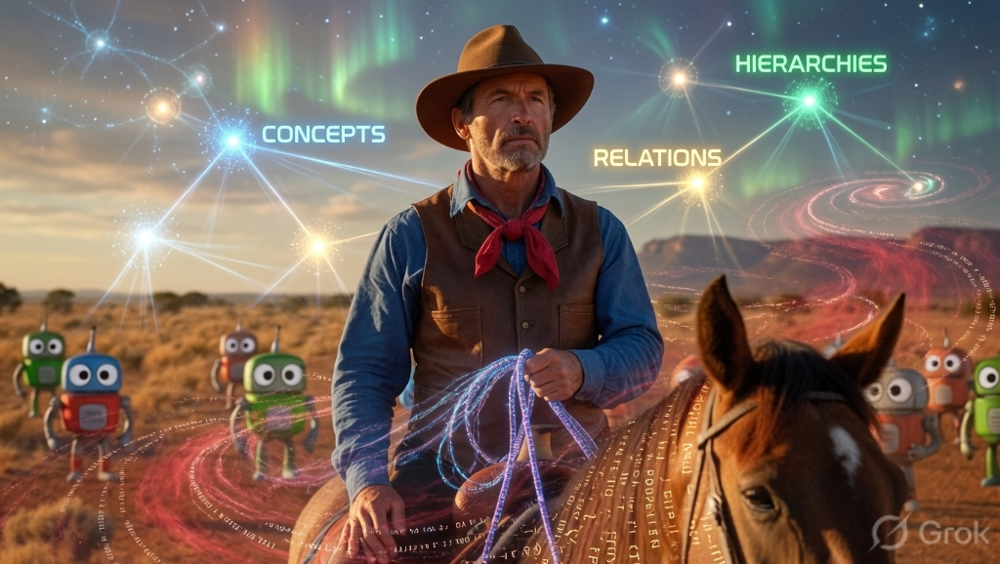

# drover-ontology

> **Repo status (rationalization 2026-11-09):** STALE — HEAD 2026-06-03. Next: reconcile governed JSONL-store boundary with Brain's LadybugDB graph projection; do not create two mutation authorities. See `docs/rlm-integration.md`.

> **⚠️ CRITICAL RULE**
>
> **Use the native Go binary (`ontology` or the `drover-ont` wrapper inside the monorepo).**
>
> This skill is implemented entirely in Go for maximum performance, strict type validation, and robust storage integrity.



Typed knowledge graph skill for the Drover ecosystem.

**Restored from ClawHub (oswalpalash/ontology)** via the shared Grok conversation and extended for Drover's [ASDL C](https://github.com/workbench-codes/workbench) (Agent Software Development Life Cycle), beads, plans, reviews, taxonomy, and cross-skill memory.

## What it gives you

- strongly typed entities (Bead, Ticket, Plan, Review, Term, Person, Task, etc.)
- Explicit relations with cardinality + acyclicity enforcement (`implements`, `depends_on`, `approves`, `blocks`...)
- Append-only audit log (`.ontology/graph.jsonl`)
- Schema validation + policy checks
- Cross-skill contracts so taxonomy, diataxis, asdlc, gstack-review, etc. can safely share state
- CLI for agents and humans

## Core Concepts: RLM & Ontology Synergy

Drover Ontology is built to power and govern **Recursive Language Models (RLMs)**.

### 1. What is a Recursive Language Model (RLM)?
Unlike standard "one-shot" AI models that attempt to read a whole codebase and guess architectural modifications in a single prompt, an **RLM operates in a closed execution loop**. The model writes Go commands that execute dynamically inside an isolated Yaegi Go REPL. It queries, analyzes, and mutates the repository structure incrementally, reacting to compiler/test errors and validation failures until it converges on a solution.

### 2. The Synergy: Why Combine RLM with a Governed Ontology?
Traditional AI agents quickly hit context limit walls, generate stale documentation, or run up massive token bills. Combining them with an ontology changes the game:
* **99% Context Size Reduction**: Instead of loading raw source files, the RLM queries the ontology's lightweight symbol map. It only requests the full text for specific, relevant symbols, keeping prompts focused and cheap.
* **Offline Local Validation**: Schema validation, dependency acyclicity, and policy checks run locally via the Go CLI. The RLM corrects its code *before* calling external APIs, preventing token-wasting infinite validation loops.
* **Zero-Token Shift-Invariance**: When codebase files are modified, a local Git-integrated AST hook automatically runs to update symbol coordinates (`line_start`, `line_end`) inside the ontology graph—with **zero token cost**.

## Installation

### Recommended: Install globally via Go

You can install the `ontology` CLI tool globally on your system using Go:

```bash
go install github.com/drover-org/drover-ontology/cmd/ontology@latest
```

### Alternatively: Build and install from source

```bash
# Clone the repository and build from source
git clone https://github.com/drover-org/drover-ontology.git
cd drover-ontology

# Installs to ~/.local/bin (no sudo required)
make install-local
```

After installation, `ontology` will be available in your PATH:

```bash
ontology --help
ontology validate --strict
```

Add `~/.local/bin` to your PATH if the binary isn't found yet:

```bash
echo 'export PATH="$HOME/.local/bin:$PATH"' >> ~/.zshrc   # or ~/.bash_profile
source ~/.zshrc
```

### Other installation methods

| Command                    | Destination              | Notes                          |
|----------------------------|--------------------------|--------------------------------|
| `make install-local`       | `~/.local/bin`           | Recommended source install     |
| `make install`             | Go's `$GOBIN` / `$GOPATH/bin` | Standard Go way             |
| `make install-system`      | `/usr/local/bin`         | May require `sudo`             |
| `go install ...@latest`    | Go bin dir               | Quickest global install from remote |

### Quick start (after installation)

```bash
# 1. Bootstrap a new workspace
./scripts/seed-drover-ontology.sh


# 2. Use the `ontology` command from anywhere
ontology create --type Bead --props '{"title":"...","kind":"task","status":"open"}'
ontology validate --strict
```

**The Go binary is the primary and only implementation.**  
All agents and all production usage (especially across drover-org) must go through the native Go CLI (`ontology`) or the `drover-ont` wrapper when working inside the monorepo.

## Installation for Cursor / Claude Code

Copy (or symlink) the skill:

```bash
# From this repo root
mkdir -p ~/.cursor/skills
ln -s "$(pwd)/.cursor/skills/ontology" ~/.cursor/skills/drover-ontology
# or just rely on the local .cursor/skills/ontology already present in the repo
```

Then invoke with `/ontology` or `/drover-ontology` (depending on your router).

## Key commands

See `ontology --help` and [SKILL.md](SKILL.md) for the full mental model + workflows.

Common patterns:
* `ontology create` + `ontology relate` to wire plans → reviews → beads → tickets.
* `ontology query` + `ontology related --depth 2` for impact analysis and dependency graphs.
* `ontology validate` before major planning or before landing changes to check schema policies.

### 🌐 Interactive Visualizer

Drover Ontology includes a premium visual graph explorer. You can boot the visualizer natively over any target directory:

```bash
ontology visualize [path_to_target_codebase]
```

This launches a lightweight Go server and automatically opens your system browser to show a dark-themed force-directed network graph featuring:
* Real-time semantic node searches and camera pans.
* Side-by-side node property inspectors and clickable direct-relation lists.
* **OS-Level deep linking**: Click on mapped code positions to open VS Code or Cursor natively positioned exactly at the targeted source code coordinates!

---

## 🤖 GitHub Actions CI Policy Gate

You can enforce ontology schema and relationship constraints automatically inside your CI/CD pipelines using our reusable composite GitHub action:

Create `.github/workflows/ontology-ci.yml` in your target repository:

```yaml
name: Ontology Policy Assurance Gate

on:
  push:
    branches: [ main, master ]
  pull_request:
    branches: [ main, master ]

jobs:
  validate-ontology:
    runs-on: ubuntu-latest
    steps:
      - name: Checkout Code
        uses: actions/checkout@v4

      - name: Verify Schema Compliance
        uses: drover-org/drover-ontology/.github/actions/ontology-validator@main
```

This action compiles the CLI, executes policy verification, parses local Git diff boundaries, and prints Github PR workflow warnings if developer commits violate standard schema rules.

---

## Storage & safety

* **Hybrid Architecture**:
  * `.ontology/graph.jsonl` is the local **append-only source of truth** containing raw operations.
  * `.ontology/graph.db` is the local **SQLite database projection** used for fast relational queries.
* **Throwaway Cache**: The SQLite database is strictly a projection. If `graph.db` is deleted, corrupted, or falls out of sync with the log offset, the CLI will automatically rebuild the SQLite cache from the JSONL log on the next run.
* `.ontology/schema.yaml` is the versioned target validation schema.
* Never hand-edit files inside `.ontology/`.
* Snapshots and exports live inside `.ontology/snapshots/`.


## Development & Testing

- [docs/TESTING_STRATEGY.md](docs/TESTING_STRATEGY.md) — Property-based testing and fuzz testing plan
- [docs/PATH_TO_PRODUCTION.md](docs/PATH_TO_PRODUCTION.md) — Prioritized roadmap to make this system production-ready
- [docs/PRODUCTION_READINESS_SCORECARD.md](docs/PRODUCTION_READINESS_SCORECARD.md) — Lightweight living scorecard (update this regularly)
- [beads.json](/beads.json) — Trackable work items with acceptance criteria (use with beads-queue tools)

Current test coverage lives in `internal/ontology/`. Run:

```bash
make test
make test-generative   # fuzz + property tests (when implemented)
```

## Provenance


- Original design: ClawHub community skill `oswalpalash/ontology`
- Restored & published via Grok share conversation
- Extended here for Drover's full workbench (beads, [ASDL C](https://github.com/workbench-codes/workbench) for agent workflows, reviews, taxonomy, gstack)

## Next steps (roadmap ideas)

- MCP server exposing the graph to remote agents
- TypeScript / Go ports of the core
- Visual graph explorer (Excalidraw export + interactive)
- Automatic sync adapters for Linear + GitHub + Notion
- Causal inference layer on top of Action + ontology mutations (self-improving agents)

---

Maintained as part of the Drover agent toolkit. Use it. Extend it. Make every agent that touches Drover work share the same living map of reality.
