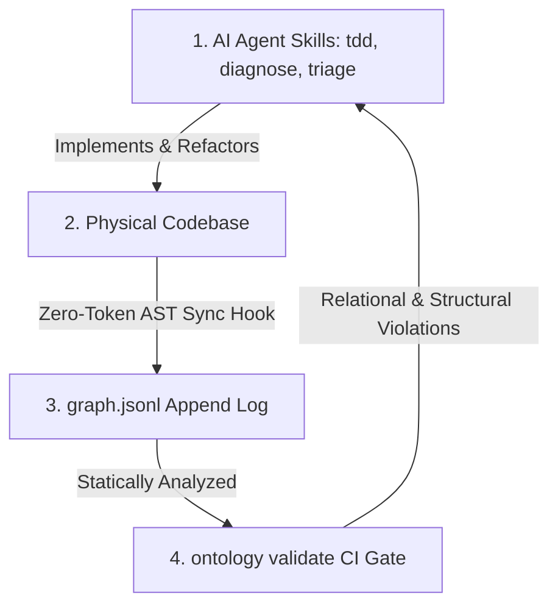

# The Cognitive Map: How Governed Ontologies Supercharge Autonomous AI Developer Skills

In the era of agentic AI, software engineering is undergoing a seismic shift. Developers are no longer just writing code lines; they are pairing with autonomous agents equipped with tools to edit files, compile code, execute test suites, and orchestrate deployments. 

Tools like Cursor, Windsurf, and specialized LLM developer loops are exceptionally capable at **tactical execution**—writing unit tests, resolving syntax errors, and refactoring isolated modules. 

However, as codebases grow, these agents face a critical bottleneck: **Architectural Drift and Documentation Decay**. 

An agent can read a single file perfectly, but it lacks a formal, machine-readable cognitive map of the entire system's architectural policies, domain boundaries, and conceptual relationships. It is forced to either load massive megabytes of source files into its context window (exhausting token limits and driving high costs) or make blind, "one-shot" architectural assumptions.

To solve this, we developed the **Drover Governed Ontology**—a platform that records and enforces your codebase's semantic reality. Far from being a static wiki page, a governed ontology acts as a live, strongly-typed **Cognitive Map** that supercharges the core engineering skills of your AI coding assistants.

Here is how combining a governed ontology with autonomous AI skills unlocks the next level of software engineering: **the self-governing codebase**.

---

## 🧠 The Missing Link: Tactical Agents vs. Strategic Architecture

To understand the power of this combination, we must look at how standard AI developer skills (TDD, bug diagnosis, triaging, and documentation) interact with a codebase's structural rules.

Traditionally, agents navigate a project using flat documentation files (like `README.md`, `CONTEXT.md`, or text-based ADRs). While useful for humans, these files suffer from two fatal flaws:
1. **Inevitability of Decay**: The moment a developer refactors a module or moves a directory, the text documentation immediately drifts, becoming stale and misleading.
2. **Lack of Machine-Readability**: An AI cannot easily execute standard query algorithms, validation checks, or topological analysis over plain markdown sentences.

By introducing a **Governed Ontology**, we model the system as a strongly-typed domain graph—representing entities (`Bead`, `Task`, `Plan`, `Review`, `Term`) and enforcing strict, acyclic relational rules (`implemented_in`, `depends_on`, `governed_by`). 

This graph is version-controlled directly inside the repository (`.ontology/graph.jsonl`) and projected into a lightweight local SQLite database.

With this architecture active, the AI agent is no longer blind. It has an authoritative, queryable directory of the codebase's semantic reality.

---

## 🚀 How Drover Ontology Supercharges Daily AI Skills

Let's break down exactly how `drover-ontology` integrates with and amplifies the core daily engineering skills used by advanced developer agents:

### 1. `[diagnose]` — High-Fidelity Bug Isolation & Deep-Linking
* **The Challenge**: When a bug or regression occurs, an agent must spend significant context space locating *where* the affected code structures actually live across a complex monorepo.
* **The Ontology Synergy**: In Drover, every conceptual domain term is mapped back to its physical implementation files using the `ParseFileSymbols` code analyzer. 
* **The Superpower**: Because the ontology records exact code lineages (`src_path`, `line_start`, `line_end`), the local visualizer sidebar exposes instant local protocol deep-links (`vscode://` or `cursor://`). The `diagnose` agent reads this metadata and **jumps directly to the exact line ranges** in the host editor to isolate and instrument the bug natively, eliminating guesswork.

### 2. `[grill-with-docs]` — Static Architecture & Contract Enforcement
* **The Challenge**: When designing a new feature, a "grilling" session challenges the plan against the existing domain model to avoid duplication or boundary violations, traditionally relying on manual reviews of ADRs.
* **The Ontology Synergy**: The ontology *is* the formal contract. Instead of treating system specifications as loose text, the agent can execute the `ontology validate` tool directly against the active `.ontology/schema.yaml` schema rules.
* **The Superpower**: If the agent's proposed code modifications introduce a relationship that violates design rules—such as creating an active development `Plan` without a designated `Reviewer` role—the local validator instantly catches the violation, providing the agent with precise compilation-style errors to self-correct before committing.

### 3. `[triage]` — Verifiable Task State Machines
* **The Challenge**: Managing issue backlogs and verifying when work is "done" usually involves human-in-the-loop validation of JIRA or GitHub cards.
* **The Ontology Synergy**: Drover models developer tasks (`Bead`, `Task`, `Ticket`) as first-class nodes in the semantic graph.
* **The Superpower**: The agent can automate the triage loop by programmatically updating node attributes and verifying graph relations. The ontology's fsck engine validates that a ticket cannot transition to `closed` or `verified` unless all relational checks (e.g., verifying that the task was `governed_by` a designated curator and all related codebase lines are successfully mapped) are 100% satisfied.

### 4. `[improve-codebase-architecture]` — Topological Refactoring
* **The Challenge**: Code checking tools (like linters) analyze local code styling, but cannot detect broad, strategic architectural flaws.
* **The Ontology Synergy**: The ontology can be exported instantly to standard Cypher query scripts, JSON-LD, or Graphviz DOT diagrams via the CLI (`ontology export`).
* **The Superpower**: The refactoring agent can run standard graph database queries over the exported schema to calculate the system's structural integrity:
  * **Hotspot Detection**: Querying nodes with exceptionally high in-degree relations to isolate bloated bottlenecks.
  * **Modular Leakage (Orphans)**: Finding codebase packages and methods that are physically implemented but completely unregistered to any business term, highlighting dead code.
  * **Circular Dependencies**: Statically verifying that package interactions remain strictly acyclic.

### 5. `[tdd]` — Machine-Readable Acceptance Contracts
* **The Challenge**: Translating abstract human requirements into concrete test assertions.
* **The Ontology Synergy**: Drover's task registry (`beads.json`) structures every task with an array of five explicit, machine-testable **Acceptance Criteria**.
* **The Superpower**: The `tdd` agent reads the criteria directly from the structured registry, scaffolds five matching unit/integration tests, compiles them, and iterates in a red-green-refactor loop. It turns loose specifications into strict, verifiable programmatic boundaries.

### 6. `[zoom-out]` — Preserving Context Budgets via Graph Navigation
* **The Challenge**: An agent landing in a new monorepo struggles with context window limits, having to read folders of source files to understand the big picture.
* **The Ontology Synergy**: The ontology represents a curated, lightweight directory of the codebase.
* **The Superpower**: When the agent needs to zoom out, it queries the local ontology server to obtain a high-level visual sub-graph. It can immediately see how the module it is currently editing relates to upstream packages and downstream APIs. The context footprint shrinks **by over 99%** (reducing megabytes of source code down to a few kilobytes of clean graph metadata), preserving token budgets and slashing API costs.

---

## 🛠️ The Virtuous Loop: Maintaining the Map for $0.00

The ultimate promise of the Drover Ontology is that **maintaining this cognitive map costs absolutely nothing in ongoing AI tokens**.

In a traditional setup, keeping architectural diagrams up-to-date would require constantly querying an LLM to parse modified files and update diagrams—a highly expensive and fragile process.

Drover solves this by deploying a local, zero-token cost **AST Shift Invariance Hook** (`sync-ast-lineages.js`) and a Git pre-commit hook (`pre-commit.sh`):
1. **Developer / Agent Edits Code**: The developer or AI agent edits class definitions, shifts methods, or modifies data structures natively.
2. **Local Git Interception**: The Git `pre-commit` hook intercepts the commit locally in less than **0.2 seconds**.
3. **AST Shift Tracking**: The hook executes a lightweight JavaScript AST parser that walks the physical files, calculates how lines have shifted, and automatically appends `update` operations to the append-only `.ontology/graph.jsonl` log.
4. **Validation Check**: The hook triggers the local compiled Go validation CLI (`ontology validate`) to verify that the active codebase state complies with all design policies.
5. **Clean Slate Commit**: If validation passes, the commit is committed to history. If it violates design rules, the commit is blocked with detailed, actionable terminal diagnostics.

---

## 🎯 Conclusion: Codebases that Govern Themselves

By combining **tactical AI developer skills** with a **strongly-typed Governed Ontology**, we bridge the code-architecture gap permanently. 

AI coding assistants get an authoritative, high-fidelity GPS map to guide their edits, prevent context exhaustion, and automate bug isolation. At the same time, the development team gets mathematical enforcement of their architectural boundaries at every pull request.

The result is a self-documenting, self-validating system where code and architecture maps always reflect reality. The era of codebase drift is officially over.
