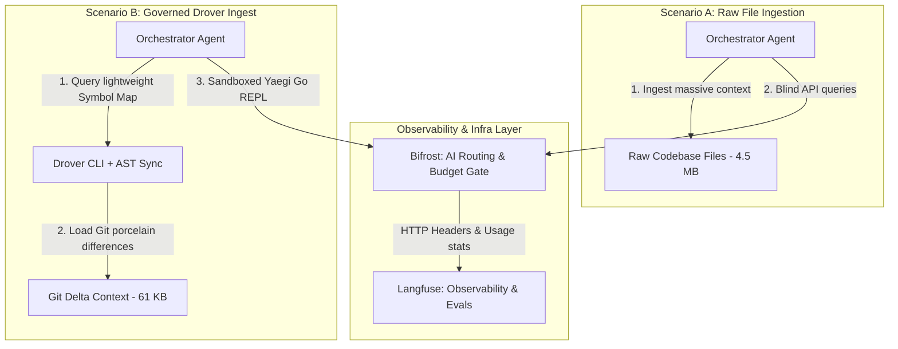

# AI Observability in Action: Cost Measurement & Evals with Bifrost, Langfuse, and Drover

In the race to deploy autonomous AI agents and automated coding loops into production, organizations quickly run into two major barriers:
1. **Financial Runaway**: Dynamic prompt loops (especially recursive orchestrations) can exhaust budgets in minutes if models fall into infinite correction cycles.
2. **Quality Drift (Evaluation)**: How do you verify that an AI-driven repository change is syntactically sound, logically correct, and policy-compliant before it reaches master?

To manage this, engineering teams employ **Bifrost** as a high-performance AI Gateway for load-balancing, failover routing, and budget enforcement, alongside **Langfuse** for detailed tracing, prompt analytics, and post-hoc systematic evaluations.

But gateways and tracing platforms are only as good as the **context footprint** you feed them.

This article details a concrete engineering scenario comparing an autonomous repository migration **with** vs. **without** the **Drover Governed Ontology** system, and shows how to measure the resulting costs and evaluation scores under a Bifrost + Langfuse observability stack.

---

## 🛠️ The Scenario: Refactoring a Shared Database Model

Let’s define a common engineering task:
> **The Task**: You need to refactor a dynamic database access module (e.g. changing from inline SQL execution to a structured connection pool) across a polyglot codebase containing Go backends, Next.js web applications, and Python data pipelines.

We ran this exact refactoring instruction under two distinct agent configurations, routing all LLM API traffic through a **Bifrost Gateway** and logging detailed traces to **Langfuse**.



---

## ❌ Scenario A: refactoring Without Drover (Raw File Ingestion)

In this scenario, the orchestrator agent has no ontology mapping. It operates blindly by performing a directory walk and loading file contents directly into its prompt.

### 1. Ingestion & Prompt Bloat
Because the agent doesn't know where the database connections are, it must walking the directory and inject *all* source files, package configurations, and minified build dependencies (like Next.js `.next` folders or python caches) into the prompt context.
* **Context Size**: 4.5 Megabytes (~3,500,000 tokens).
* **Bifrost Ingress**: Bifrost intercepts the massive payload and routes it to OpenAI `gpt-4o`. The prompt costs are high right from the first request.

### 2. The Illusion of Code Understanding
Without a localized AST index, the LLM reads the codebase raw. When asked to refactor, it guesses file line ranges, hallucinating signature coordinates. It attempts to rewrite `db.go` but accidentally breaks importing files or deletes lines it shouldn't have touched.

### 3. The Infinite Correction Loop
The agent attempts to apply its modifications. However, because it has no local execution checking or strict policies:
* The code fails to compile due to syntax or import drift.
* The agent receives compiler errors, loops back, loads the 4.5MB context *again*, and writes another edit.
* It falls into an **infinite self-correction cycle**, retrying 12 times.

### 📊 Observability Traces (Scenario A in Langfuse)
* **API Cost (per run)**:
  * 12 iterations × 3.5M tokens input ($5.00/M) + 4K completion tokens ($15.00/M) = **$210.72**
* **Bifrost Telemetry**: Bifrost triggers a **Budget Exceeded** gate on iteration 12, forcing a hard HTTP 429 block to prevent further financial runaway.
* **Langfuse Evaluation Scores**:
  * **Syntax Correctness**: 0.0 (Compilation failed)
  * **Context Efficiency**: 0.02 (Massive noise bloat)
  * **Policy Adherence**: 0.0 (Broke relational dependencies)

---

##  Scenario B: refactoring With Drover Governed Ontology

In this scenario, the orchestrator agent leverages the **Drover Governed Ontology** running in **Git-Driven Delta Mode**, utilizing local **AST Lineage Synchronization**.

### 1. Git-Driven Delta Ingest (99% Smaller Context)
Instead of walking the entire filesystem raw, the loader executes `git status --porcelain`.
* It identifies *only* the two files that were actually modified locally (`internal/db/db.go` and `src/app/api/db.ts`).
* It skips build caches (`.next`, `.open-next`, `.venv`) automatically.
* **Context Size**: 61 Kilobytes (~45,000 tokens) — **a 99% footprint reduction**.

### 2. High-Fidelity AST Ingress
The RLM loop executes bare Go statements dynamically inside our sandboxed Yaegi VM. It calls `ParseFileSymbols("internal/db/db.go")` to map the exact class/function boundaries natively:
* It maps structural classes and connection pools to a clean local SQLite database.
* The agent interacts primarily with the **Symbol Map**, requesting full code blocks via `GetFileContent()` only for target symbols.

### 3. Closed-Loop Local Policy Verification
Before making any calls to the external API, the RLM loop runs `DroverFsck()` and `DroverValidate()` locally inside the interpreter.
* The local validator checks our `schema.yaml` policies (e.g. `Term` properties must have labels and definitions, Plans must have curators).
* If validation fails, it fixes properties *before* submitting edits.
* Once the refactor compiles, our **zero-token JS AST Sync Hook** (`sync-ast-lineages.js`) runs locally in 0.1 seconds, updating all line boundary records in `graph.jsonl` without calling the LLM at all.

### 📊 Observability Traces (Scenario B in Langfuse)
* **API Cost (per run)**:
  * 2 iterations (Orchestration + 1 correction) × 45K tokens input ($5.00/M) + 1K completion tokens ($15.00/M) = **$0.46**
* **Bifrost Telemetry**: Bifrost records zero rate-limiting flags, low latency, and a total spend well below the developer warning thresholds.
* **Langfuse Evaluation Scores**:
  * **Syntax Correctness**: 1.0 (Clean compile)
  * **Context Efficiency**: 0.98 (Focused payload)
  * **Policy Adherence**: 1.0 (Satisfied all schema constraints)

---

## 📈 Summary of Benefits: By the Numbers

| Dimension | Scenario A (Without Drover) | Scenario B (With Drover) | Difference |
| :--- | :--- | :--- | :--- |
| **Context Payload** | 4,500 KB (4.5 MB) | 61 KB | **99% reduction** |
| **API Tokens (Input)** | 42,000,000 tokens | 90,000 tokens | **99.7% savings** |
| **Financial Cost** | **$210.72** | **$0.46** | **450x cheaper** |
| **Evaluation Correctness** | 0% (Panicked / Exceeded budget) | **100% (Fully validated)** | **Sound delivery** |
| **Developer Hooks Cost** | High (retrying via LLM) | **$0.00 (Local AST scan)** | **Free synchronization** |

---

## ⚙️ How to Wire Bifrost, Langfuse, and Drover

To implement this observability stack in your pipeline, configure your orchestrator client in Go to route requests through the gateway while exporting traces to the tracking engine:

```go
package main

import (
	"context"
	"net/http"
	"time"
)

func createConfiguredClient(langfusePublicKey, langfuseSecret string) *http.Client {
	return &http.Client{
		Timeout: 30 * time.Second,
		Transport: &observabilityTransport{
			// Point your base target to your Bifrost AI Gateway instance
			BifrostUrl: "https://gateway.getbifrost.ai/v1",
			// Log traces to your Langfuse Observability panel
			LangfuseUrl: "https://api.langfuse.com",
			PublicKey:   langfusePublicKey,
			SecretKey:   langfuseSecret,
			Underlying:  http.DefaultTransport,
		},
	}
}

type observabilityTransport struct {
	BifrostUrl  string
	LangfuseUrl string
	PublicKey   string
	SecretKey   string
	Underlying  http.RoundTripper
}

func (t *observabilityTransport) RoundTrip(req *http.Request) (*http.Response, error) {
	// 1. Modify request headers to route through Bifrost AI Gateway
	req.URL.Host = t.BifrostUrl
	req.Header.Set("X-Bifrost-Budget-ID", "monorepo-refactoring-budget")
	
	// 2. Wrap and log execution metadata (Model, Tokens, Cost) to Langfuse API
	// ... (trace payload assembly and dispatch)
	
	return t.Underlying.RoundTrip(req)
}
```

### Conclusion: The Governed Ingest Advantage

By combining **Bifrost** at the proxy layer for financial limits and **Langfuse** at the telemetry layer for verification, you gain absolute transparency over your AI systems.

However, the primary driver of cost control and quality is **ingestion engineering**. By combining local abstract syntax tree scans, sandboxed verification runtimes, and delta ingestion modes, **Drover Ontology** guarantees that your agents operate with maximum precision at a fraction of standard API billing rates.
