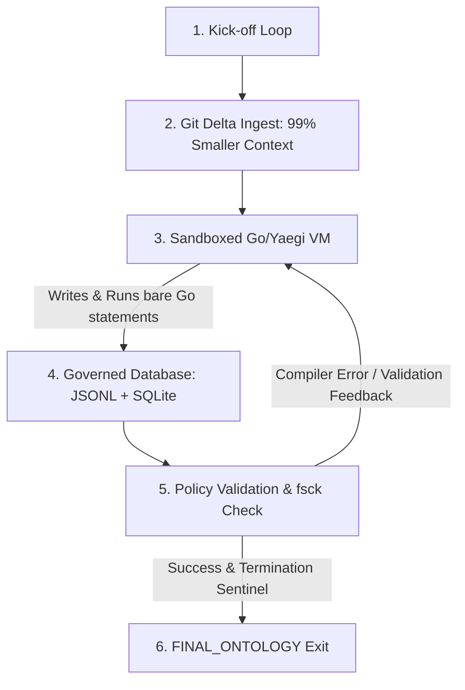

# Marketing Launch Plan: Governed RLM Ontology System

This marketing launch plan provides a complete developer-focused outreach campaign, including social media strategies, a high-energy video script, and an in-depth long-form article explaining **Recursive Language Models (RLMs)** and the **Drover Governed Ontology** in simple terms.

---

## 📅 Launch Campaign Overview

The goal of this campaign is to showcase the system to senior developers, software architects, and AI engineering practitioners. The focus is on solving **documentation decay**—specifically, how this tool connects dynamic codebase structures to architectural, governed taxonomies with zero runtime drifting and zero ongoing token costs.

---

## 1. 💼 LinkedIn Launch Post

**Target Audience:** CTOs, Principal Engineers, Engineering Managers, AI Architects.
**Tone:** Authority-building, technical, forward-looking.

```text
The drift between codebase reality and architectural documentation is a multi-million dollar problem. 

We build elegant systems, draw beautiful draw.io diagrams, and write detailed wikis. Then, the first pull request merges, code shifts, and the architecture map is instantly obsolete.

What if your codebase governed and documented itself in real time?

I am excited to introduce the Governed RLM Ontology system—a developer-first, AI-driven domain mapping tool that bridges the gap between raw code and semantic governance.

Under the hood:
1. 🧠 Recursive Language Model (RLM) Loop: An autonomous AI loop that runs inside an isolated, sandboxed Yaegi Go REPL to walk codebases, extract domain concepts, and wire standard taxonomies.
2. 🔒 Secure VM Sandboxing: Production-hardened environment that strips unsafe host packages (os, net, syscall), protecting budgets and environments from infinite recursion or execution drift.
3. ⚡ Zero-Token AST Sync: A lightweight local JavaScript synchronization hook that detects codebase line shifts and updates lineages in less than 0.2 seconds—with zero API billing cost.
4. 🕸️ Dark-Mode Force Visualizer: A premium, glassmorphic vis.js interface that lets engineers inspect lineage, track Plan review statuses, and deep-link directly into VS Code or Cursor natively.

No more scattered docs. No more stale diagrams. Just clean, self-documenting, and self-governed code.

👉 Check out the full breakdown and see how we productionized it for polyglot systems below!

#SoftwareArchitecture #AIDevelopment #DeveloperExperience #Golang #PlatformEngineering #TechLaunch
```

---

## 2. 🐦 Twitter (X) Thread Launch

**Target Audience:** Individual Contributors, AI Builders, Open-Source Enthusiasts.
**Tone:** High energy, visual, thread-first.

```text
🧵 1/ Code shifts. Diagrams decay. Architectural documentation dies.

What if your codebase mapped, synchronized, and governed its own domain taxonomy in real-time?

Introducing the Governed RLM Ontology engine. 

Here is how we built a production-grade, self-documenting system 👇

---

2/ The problem: normal LLMs can't model complex architectures in a single shot. They hit context walls, guess line ranges, and run up massive token bills.

Our solution: A Recursive Language Model (RLM) harness that runs Go statements dynamically in an isolated interpreter.

---

3/ 🔒 Sandbox Hardening:
We integrated the Yaegi Go interpreter to run AI-written code on the fly. 

But running arbitrary code is dangerous. 

We stripped unsafe standard packages (os, net, syscall) to enforce absolute sandbox containment and deterministic API timeouts.

---

4/ ⚡ Zero-Token AST Syncing:
AI tokens are expensive. We don't call LLMs when lines shift. 

Instead, we deployed a local JS scanner that hooks into git. It walks physical symbol spans and appends "update" logs to our append-only JSONL database locally.

Time: 0.1s. Cost: $0.00.

---

5/ 🕸️ Premium Visual Lineage:
Engineers explore the active graph via an interactive dark-mode force visualizer.

Click any Term, Plan, or Review node in the browser to inspect its properties, and deep-link instantly into VS Code or Cursor exactly at the line of code!

---

6/ 🏗️ This is the future of architectural governance:
✅ Git Porcelain-driven Delta Ingestion (99% context size reduction)
✅ Reusable composite GitHub Action CI check gates
✅ Automatic term curating and plan policies

Self-governed code is here. Check the long-form explainer in the bio! 🚀
```

---

## 3. 🎬 Face-to-Camera Video Script (90 Seconds)

**Visuals & Directives:**
* **Setting:** Clean developer desk, warm lighting, VS Code/Cursor visible on screen behind with a dark-mode visualizer rendering.
* **Delivery:** Direct, high energy, pacing is rapid but steady.

| Time | Speaker (On Camera) | Visual / B-Roll Overlay |
| :--- | :--- | :--- |
| **0:00** | "Every developer has lived this nightmare: You join a team, read the system wiki, look at the architectural diagrams... and then you open the codebase, only to realize *none of it matches the code*." | *Tight zoom on host. Subtle shake head.* |
| **0:15** | "Documentation decays because code is alive. But we can't expect developers to write markdown files every time they refactor a function. So we built something different: A self-documenting, self-governing system powered by an RLM loop." | *Cut to screen recording showing the dark-mode Vis.js force-directed graph spinning into focus.* |
| **0:30** | "An RLM is a **Recursive Language Model**. Unlike traditional AI that guesses in one shot, an RLM runs an active loop—writing Go statements inside a sandboxed micro-interpreter to crawl your files, trace symbol imports, and construct a database of architectural terms, plans, and reviews." | *Overlay: Graphic of Go Code executing inside a locked safe (symbolizing Yaegi Sandboxing).* |
| **0:48** | "And we productionized it to be rock-solid. It uses a Git-driven Delta Mode to reduce AI context sizes by **99%**. It locks down standard library imports so arbitrary code can't escape the VM. And when code shifts? A zero-token AST hook automatically syncs lineages in under a second—costing absolutely nothing." | *Cut to terminal showing a quick `./scripts/pre-commit.sh` running in 0.1 seconds with success checkmarks.* |
| **1:10** | "When you look at the visualizer, you aren't just looking at boxes. You can click any domain term, inspect who curates it, see its review lifecycle, and click a button to instantly open your editor—focusing Cursor or VS Code right onto the exact line." | *Show mouse clicking a glassmorphic sidebar card, triggering Cursor to pop up and focus a specific JS file line.* |
| **1:22** | "It’s time to stop writing documentation that dies. Let’s build codebases that govern themselves. I’ve written a full deep dive on how RLMs work under the hood. Check out the link below, and let’s build." | *Host smiles, gestures to link overlay. Fade to dark-mode logo.* |

---

## 4. 📝 Long-Form Deep-Dive Article

**Title:** Bridging the Code-Architecture Gap with Governed Recursive Language Models (RLMs)

---

### Introduction: The Tragedy of Document Decay

In software engineering, documentation is a promise that is rarely kept. 

We start projects with clean architectures, rigid domain vocabularies (Ubiquitous Language), and elegant boundaries. But code is fluid. In a fast-moving monorepo, files are refactored, modules are renamed, and new routes are deployed daily. 

Within weeks, a gap opens. The architectural diagrams say one thing, the ADRs (Architecture Decision Records) say another, and the physical implementation is entirely different. This is **documentation decay**, and it costs enterprise organizations millions in onboarding friction, duplicate work, and architectural drift.

To solve this, we built the **Governed RLM Ontology**—a platform that turns your codebase into a self-documenting, self-validating knowledge graph.

---

### What is a Recursive Language Model (RLM)? (ELI5 Explainer)

> [!TIP]
> ### 👶 Explain It Like I'm 5 (ELI5)
> Imagine you have a giant, messy box of LEGOs, and you want to build a beautiful castle. 
> 
> A **normal AI** is like a builder who stands far away, looks at the box once, and tries to draw a picture of a castle from memory. Usually, they get some parts right, but they make mistakes because they can't touch the LEGOs or check if they fit together.
> 
> A **Recursive Language Model (RLM)** is like a smart little robot builder who jumps right into the box! 
> 
> The robot can pick up a brick, try to connect it to another, and see if it snaps together. If a brick doesn't fit, the robot doesn't give up—it throws it away, grabs a different one, and tries again. It talks to itself, checks its instructions, and keeps building piece-by-piece until it has built a perfect castle.
> 
> In our system, the "box of LEGOs" is your codebase, the "bricks" are your lines of code, and the "perfect castle" is a beautiful, working map of your software architecture.

---

### The Power of RLM: Moving from "One-Shot" to "Closed-Loop"

Traditional AI code analysis suffers from two fatal flaws:
1. **Context Exhaustion**: Massive codebases exceed prompt token windows. Loading 5MB of source code into a prompt leads to high costs and halluncinations.
2. **Open-Loop Execution**: The model writes a code snippet or generates an analysis but has no way of knowing if its code compiles, if its assumptions are valid, or if its outputs conform to policies.

An **RLM solves this by working in a closed execution loop**:



By allowing the AI orchestrator to write Go code executed dynamically inside a safe micro-interpreter, the AI can call helper functions (`ListFiles`, `ParseFileSymbols`, `FindReferences`) to explore the codebase incrementally. It only reads full file contents when absolutely necessary, preserving context space and slashing API costs.

---

### Production Hardening: Safety at Scale

Running model-generated code dynamically is highly powerful but introduces architectural risks. Here is how we hardened the Drover ontology loop for production-readiness:

#### 1. Unsafe Package Stripping
We decoupled Yaegi execution from the host shell. Standard library packages that permit arbitrary disk or network I/O (`os`, `os/exec`, `syscall`, and `net/*` network calls) are stripped from the VM runtime catalog. The model can only interact with mathematical libraries, string parsers, and explicit, bounded `Drover*` API mutation hooks.

#### 2. Local Zero-Token AST Syncing
Lineage trackers require recording the exact line numbers (`line_start`, `line_end`) of code structures. When developers refactor files locally, these lines shift. 

To avoid the token cost of constantly querying an LLM to update simple line ranges, we deployed a local, AST-aware JavaScript script (`sync-ast-lineages.js`) and a Git pre-commit hook (`pre-commit.sh`). 

The hook intercepts commits, parses physical file contents to detect symbol shifting, and appends `update` operations to the append-only `graph.jsonl` log in **less than 0.2 seconds** for a cost of **$0.00**.

#### 3. Continuous Integration Policy Gates
Documentation is only valuable if it is enforced. We built a reusable composite GitHub Action CI check. Every time a developer opens a Pull Request, the validator tests the graph constraints:
* Are all new `Term` objects governed by a curation role (`governed_by`)?
* Does the taxonomy hierarchy remain acyclic (`broader_term`)?
* Do approved plans have the required reviews?

If any constraint is violated, the check fails, PR annotations are raised, and merging is blocked—preventing architectural decay before code ever reaches production.

---

### Conclusion: Codebases that Document Themselves

By combining **Recursive Language Models (RLMs)** with **governed relational databases**, **isolated VMs**, and **zero-token local AST sync hooks**, the Drover Ontology provides a blueprint for modern enterprise development. 

Developers get to focus entirely on writing high-quality code. The system takes care of mapping symbols, enforcing boundaries, synchronizing lineages, and ensuring that your architecture maps always reflect codebase reality.

The gap between code and documentation is finally closed.
